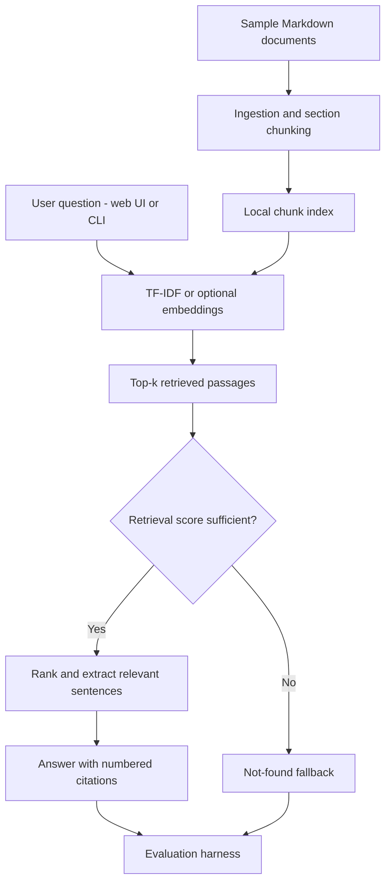

# RAG Knowledge Assistant — MVP Prototype

IBM SkillsBuild AI Experiential Learning Lab — final submission prototype (November 22, 2026).

A local knowledge assistant for IT support and operations documents. It retrieves relevant passages, constructs extractive answers with numbered source citations, and attempts to decline questions that are not covered by the pilot corpus.

## Current scope

- Markdown document ingestion, section-based chunking and metadata.
- NumPy TF-IDF retrieval with cosine similarity; optional MiniLM embedding retrieval.
- Extractive answers with source citations and an insufficient-evidence fallback.
- Command-line interface, local browser UI and a 20-question evaluation harness.

**Limitations:** this is a retrieval-augmented extractive QA MVP, not a deployed generative RAG system. No generative LLM, IBM Cloud or watsonx.ai service is configured. The eight documents are synthetic samples, not real company policies. The latest evaluation identifies missed answers and incorrect answers to out-of-scope questions. See [BUILD-NOTES.md](BUILD-NOTES.md) for the implementation history and AI-tool disclosures.

## Architecture



## Quick start

Python 3.10+ is required. Start with the verified TF-IDF baseline; only NumPy is needed.

### Windows PowerShell

```powershell
git clone https://github.com/Swamy2255/rag-knowledge-assistant-mvp.git
cd rag-knowledge-assistant-mvp
py -m venv .venv
.\.venv\Scripts\python.exe -m pip install "numpy>=1.26"
.\.venv\Scripts\python.exe -m rag_mvp.cli ingest
.\.venv\Scripts\python.exe -m rag_mvp.cli demo
.\.venv\Scripts\python.exe -m rag_mvp.eval
.\.venv\Scripts\python.exe -m rag_mvp.app
```

### macOS / Linux

```bash
git clone https://github.com/Swamy2255/rag-knowledge-assistant-mvp.git
cd rag-knowledge-assistant-mvp
python3 -m venv .venv
source .venv/bin/activate
python -m pip install "numpy>=1.26"
python -m rag_mvp.cli ingest
python -m rag_mvp.cli demo
python -m rag_mvp.eval
python -m rag_mvp.app
```

Open http://127.0.0.1:8080 in your browser. Stop the local server with Ctrl+C.

Optional: install `sentence-transformers` to enable the implemented MiniLM backend (requires a model download and additional dependencies). Re-evaluate and calibrate it separately; its behavior is not established by the TF-IDF results below.

## Repository layout

```text
corpus/                  8 synthetic support/ops documents
rag_mvp/
  ingest.py              Markdown ingestion and chunk index
  retrieval.py           TF-IDF and optional embedding retrieval
  answer.py              Extractive answers and fallback
  cli.py                 ingest / ask / repl / eval / demo
  eval.py                Evaluation harness
  app.py                 Local HTTP UI (GET /, POST /ask)
eval/
  questions.jsonl        20 questions (12 answerable, 8 unanswerable)
  results.json           Latest committed evaluation
scripts/demo.sh          CLI demo (macOS / Linux)
index/                   Generated locally; not committed
```

## Evaluation — November 21, 2026

The original 10-question pilot passed all 10. Following coach feedback, the evaluation grew to 20 questions, including harder paraphrases and near-miss unsupported requests.

Latest committed run: TF-IDF backend, default threshold 0.30. Source: [eval/results.json](eval/results.json).

| Metric | Result | Target |
| --- | ---: | ---: |
| Overall passes | 16/20 (80%) | — |
| Grounded-answer rate (harness pass criteria) | 10/12 (83.3%) | 90% |
| Citation coverage | 100% of non-fallback responses | 100% |
| Correct-fallback rate | 6/8 (75%) | — |
| False-fallback rate | 2/12 (16.7%) | — |
| Median measured retrieval latency | 0.0 ms (rounded) | — |

The evaluation uses expected retrieved-document IDs, keywords, citations and fallback behavior as proxy criteria; it is not a comprehensive human assessment of factual accuracy. The latency timer measures retrieval, not full end-to-end response time. Results apply only to the small synthetic pilot corpus.

### Findings and next steps

- Two supported questions (VPN after password change and sick-day allowance) were incorrectly declined.
- Two unsupported questions (contractor parental leave and resetting another person's password) received answers that did not match the question's scope.
- Simple threshold changes cannot separate the observed near-miss scores reliably. Future work: stemming or calibrated semantic retrieval, explicit scope checks, a grounded generation layer, stronger independent evaluation and tests on approved real documents.

## Three-minute demonstration

1. Show the corpus and its metadata.
2. Ask: "How do I reset my password if I forgot it?" Show the answer and citations.
3. Ask: "What is the Wi-Fi password for the guest network?" Show the fallback.
4. Run `python -m rag_mvp.eval` and explain the 16/20 results and limitations.
5. Show the local web UI and explain the planned generative layer.

## Submission status

- Public code repository: https://github.com/Swamy2255/rag-knowledge-assistant-mvp
- Evaluation report: [eval/results.json](eval/results.json)
- Problem and Solution Statement, Technology Statement and public demo video: submit through the program's required channel.
- IBM Bob and watsonx.ai were not used in the original prototype build; see [BUILD-NOTES.md](BUILD-NOTES.md) for the access limitations. Do not claim usage without evidence.
